# polymux

polymux (command: `pm`) is a web control plane for one developer's Linux host. It shows your
projects, their git state, your tmux sessions and the coding agents running in
them, in one place. You can launch agents, read and answer their chats, stop
them, and watch the host's containers and VMs.

It is a single-user tool. It runs on the host as a normal user, binds to
loopback, and is meant to sit behind a TLS reverse proxy.

Stack: Python 3.13, FastAPI, Jinja2, uvicorn, vendored HTMX. No JavaScript
build step.

> **Status: early, under active development.** I have been building polymux
> for only about 10 days, so it still has bugs. It is a working tool I use
> every day, but it moves fast: pages change and some parts are unfinished.
> Contributions are very welcome: bug reports, ideas, fixes, support for more
> coding agents, new themes. See [CONTRIBUTING.md](CONTRIBUTING.md).

## Why I built this

I'm a technical guy, not a developer. I built polymux as my own place to
experiment with coding agents, and I want to use *every* coding agent out
there, not only Claude Code or Codex.

I work in the terminal a lot and keep many sessions open at once, usually 10
to 50 tmux sessions. With that many, it gets very hard to keep track of them:
which agent is waiting for me, what each one answered, and where the docs they
wrote ended up.

I also switch screens all day. At work it's a MacBook Pro 14", with or without
a Dell 27" 2K monitor. Outside, it's only an iPhone 17 Pro Max. At home, a Mac
mini on a 34" ultrawide. I needed one place I can open from any of them and
still see everything I'm working on.

And it's not only about building software. Much of what runs in those tmux
sessions is servers, infrastructure and networking work. polymux keeps all of
it in one view: agents, shells, projects, git, containers and VMs.

The cool part: polymux is where I work on all my other projects, so I keep
fixing polymux along the way. Every rough edge I hit while doing something
else turns into the next fix.

Another cool thing: polymux stays in sync with tmux. Every agent and shell is
a real tmux pane, so you can type in tmux or in the web UI, from the laptop or
the phone, and it doesn't matter: both show the same session.

Where it runs: polymux and your agents run on a Linux VPS or dedicated server,
and every device you own is just a browser pointed at it. That is on purpose:
I don't want coding agents running on my own laptop or phone. Your devices
never run agents, and you can still reach everything from anywhere. If you do
want it on your own machine, that works too: install it on any Linux box you
like.

And I want it self-hosted as much as possible. I'd rather not build on a
provider's website, and I don't want to copy things back and forth between
tools and machines. Everything should live in one place that I choose, and be
there when I need it.

## Features

| Area | What you get |
|---|---|
| Inbox | All running agents grouped Waiting for you / Running / Idle, with last message, unread badges, recap, exit and resume. Ended agents keep a permanent page. |
| Agents | Launch Claude Code, Codex, Devin, Cursor Agent or Antigravity in a new tmux window (model, effort, permission mode, optional git worktree). Fork, continue, review, stop all. Library of installed skills, rules, scripts and MCP servers per agent. |
| Chat | Live chat view of each agent (detail or compact), composer with queued messages, file attach and snippets. Quick chat: one-off `claude -p` conversations with history. |
| Projects | Every folder under `dev_root` is a project: agents, tmux sessions, compose stack, VMs, TODO, backlog, plans, files browser. |
| Tracker | Issues, TODO tasks, CHANGELOG and FEATURES entries live in SQLite and are rendered to Markdown. Agents use the `pmctl` CLI. |
| Git | Status badges (dirty / ahead / behind), fetch, pull, push, history with commit links, remotes editor limited to hosts you allow. |
| tmux | Sessions, windows and panes; new session; kill with guards; optional read-only browser terminal. |
| Servers / VMs | Host resources, processes, Docker containers (stop / restart / kill with protected globs), libvirt VMs, reachability of other hosts. |
| Notifications | Agent state changes and host health alerts to ntfy; ntfy topics mirrored into the Inbox. Optional Claude Code hook for instant state. |
| Builder | Agent chat on the left, sandboxed live preview of the project's static files on the right. |
| Security | Token or passkey login, optional TOTP unlock, CSRF + Origin checks, tiers, protected tmux sessions, audit log. |
| Phones | Phone layout with a tab bar; checked on iPhone WebKit. |

Optional features hide themselves when their tool is missing (no Docker: no
Stacks; no libvirt: no VMs; no ntfy URL: no ntfy).

## Themes

| Theme | What it is |
|---|---|
| `classic` (default) | Sidebar layout with a phone tab bar. Rules: [docs/UI-RULES.md](docs/UI-RULES.md). |
| `dt` | Keyboard-driven shell: tabs, a sessions sidebar, command menus and layered panels. Vim-style navigation (`J`/`K` to move through lists, `G` then a letter to jump to a page, `/` to filter, `?` for all keys) and macOS-style search and switching (⌘K search everything, `>` for commands, ⌘P go to session, ⌘B sidebar, ⌘, settings; Ctrl on Linux/Windows). Rules and design: [docs/themes/dt/](docs/themes/dt/README.md). |

Pick a theme per browser in Settings (or `?ui=dt`), or set the server default
with `theme = "dt"` in `pm.toml` ([docs/CONFIG.md](docs/CONFIG.md)).

> **Both themes still have bugs.**
> - `classic` (the default) works, but has open UI bugs: a low-contrast
>   "Working…" label, columns that clip without an ellipsis, rows that stretch
>   too wide on 27"/34" screens, a cramped ntfy page and a few iPhone wrapping
>   and overlap glitches.
> - `dt` is newer and still being built: some pages are not ported yet and
>   render their classic version inside the dt shell, and it has its own rough
>   edges.
>
> Bug reports and fixes for either theme are very welcome: open an issue or a PR.

## Screenshots

All shots use fixture data from the dev instance (`tools/devpm.py`), not a real host.

### dt theme

Desktop 1440x900 (Chromium) and iPhone 440 wide (real WebKit), light and dark.

| Light | Dark |
|---|---|
| 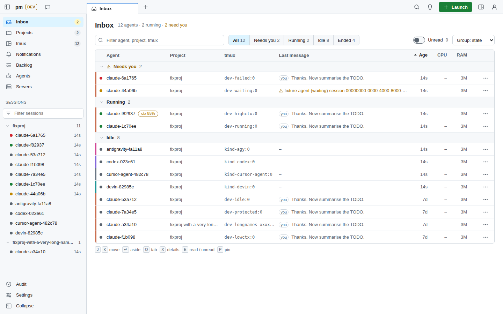 | 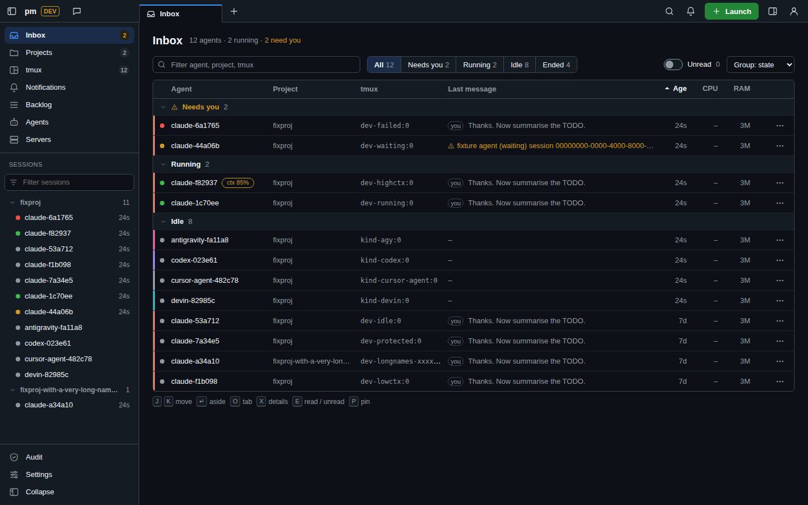 |
| 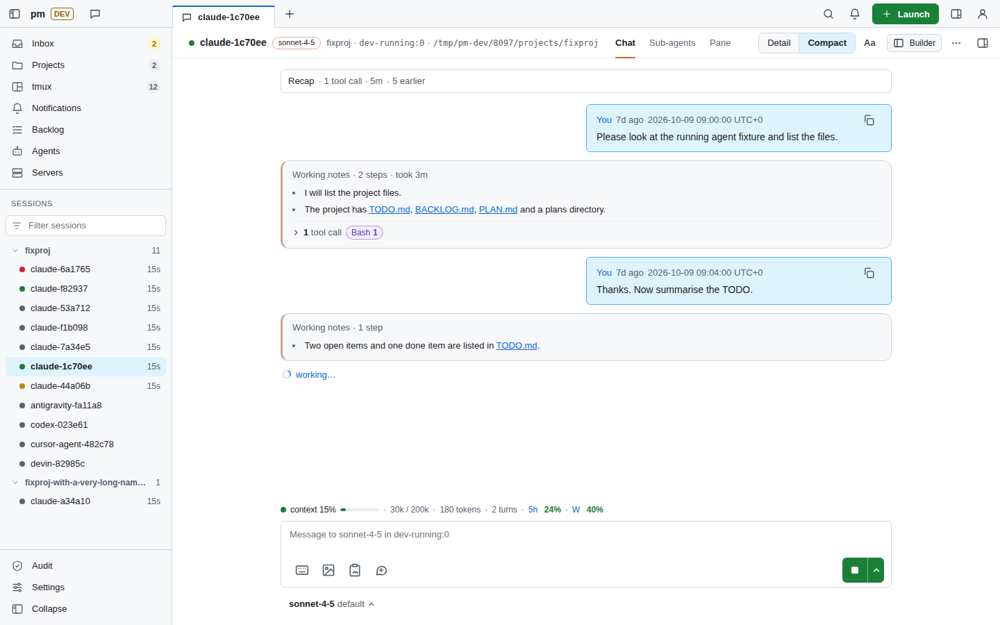 | 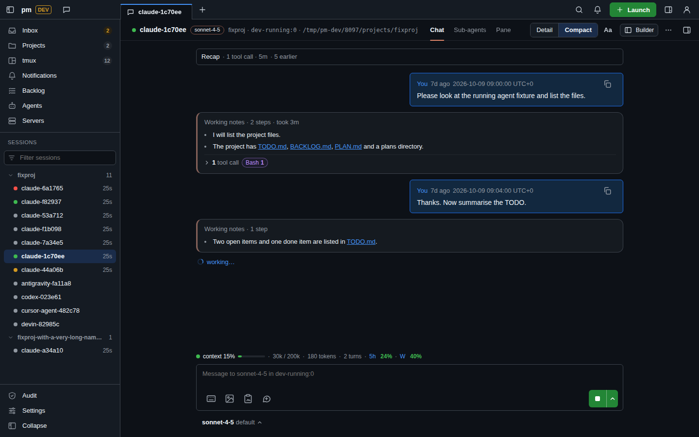 |

| iPhone Inbox, light | iPhone Inbox, dark | iPhone chat, light | iPhone chat, dark |
|---|---|---|---|
| 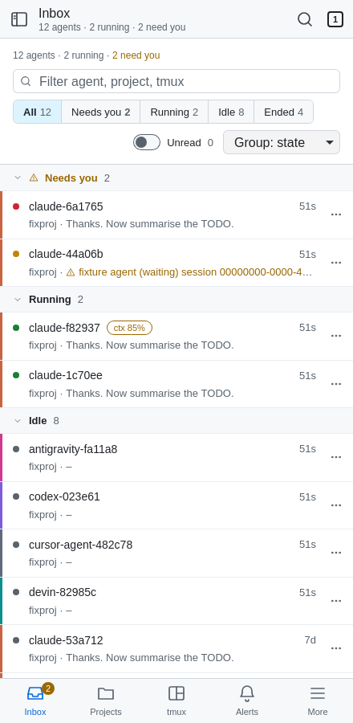 | 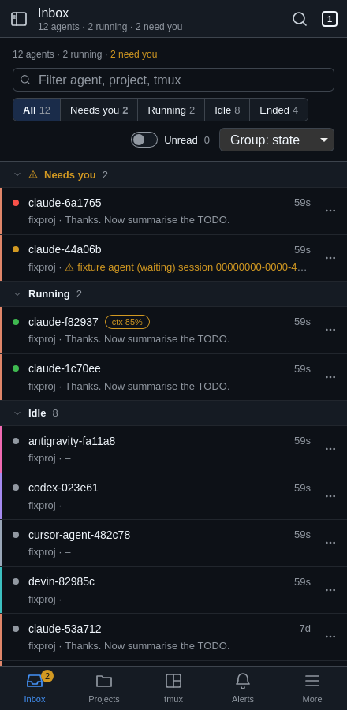 | 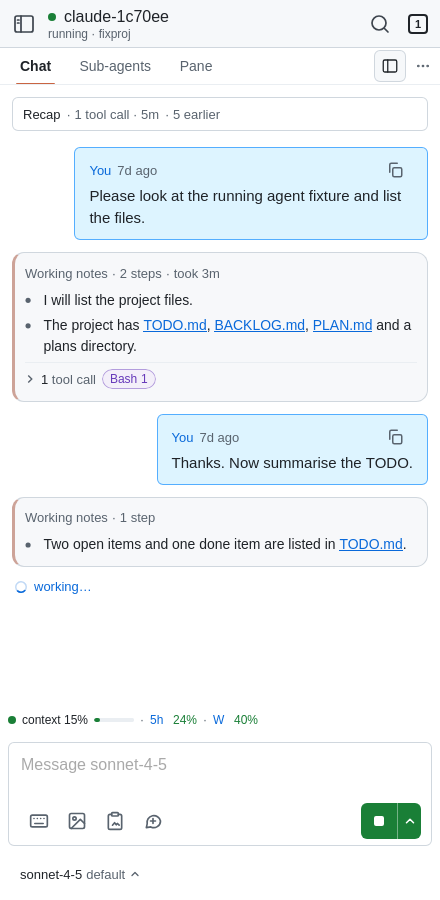 | 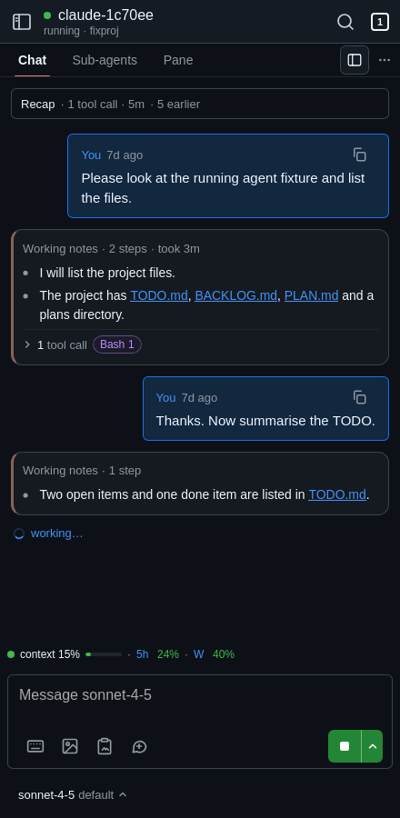 |

More: project ([light](docs/screenshot/dt/03-project-light.png), [dark](docs/screenshot/dt/03-project-dark.png)),
tmux ([light](docs/screenshot/dt/04-tmux-light.png), [dark](docs/screenshot/dt/04-tmux-dark.png)).

### classic theme

Desktop, 1440x900 at 2x. Each shot also exists in dark mode (`-dark.png`) in the same folder.

| Inbox | Agent chat |
|---|---|
| 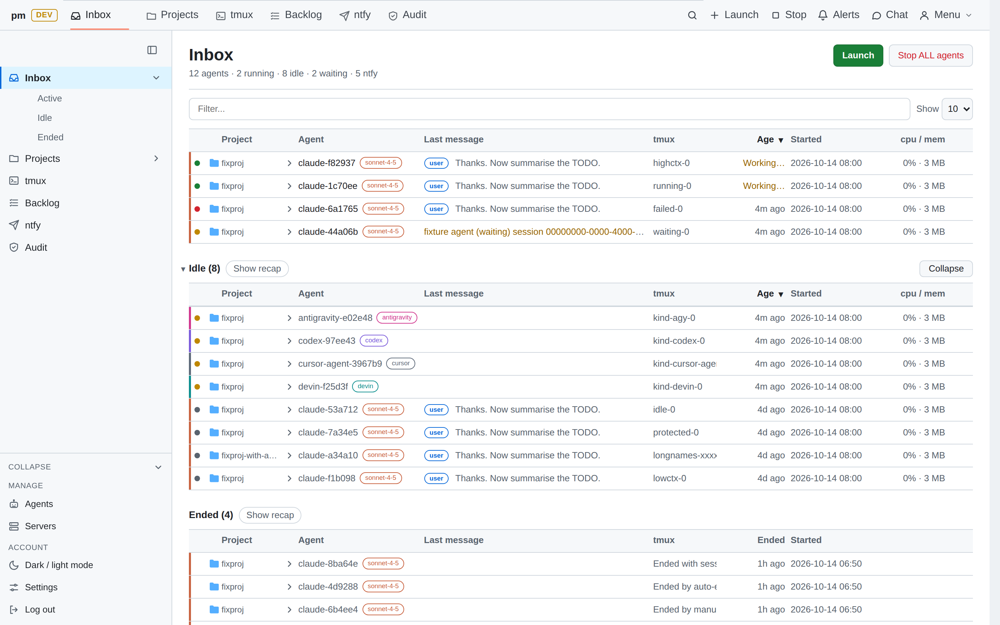 | 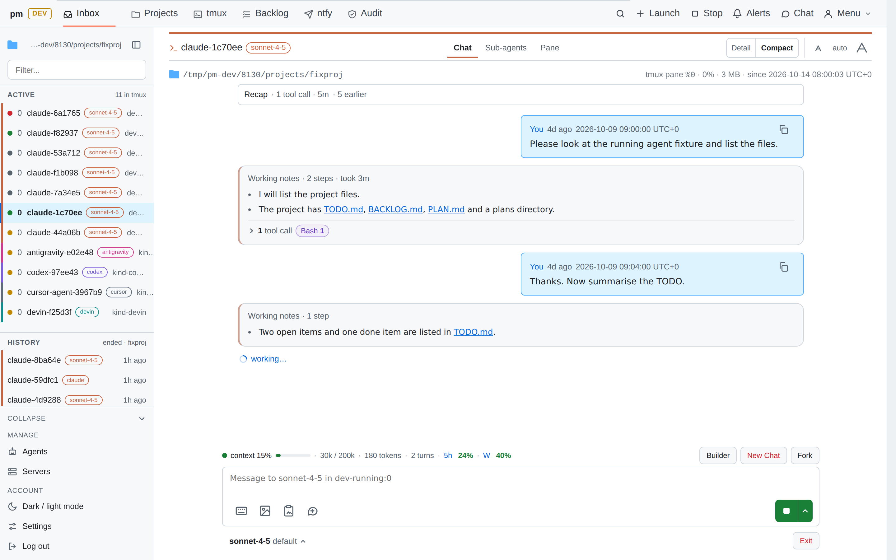 |
| **Project** | **tmux** |
| 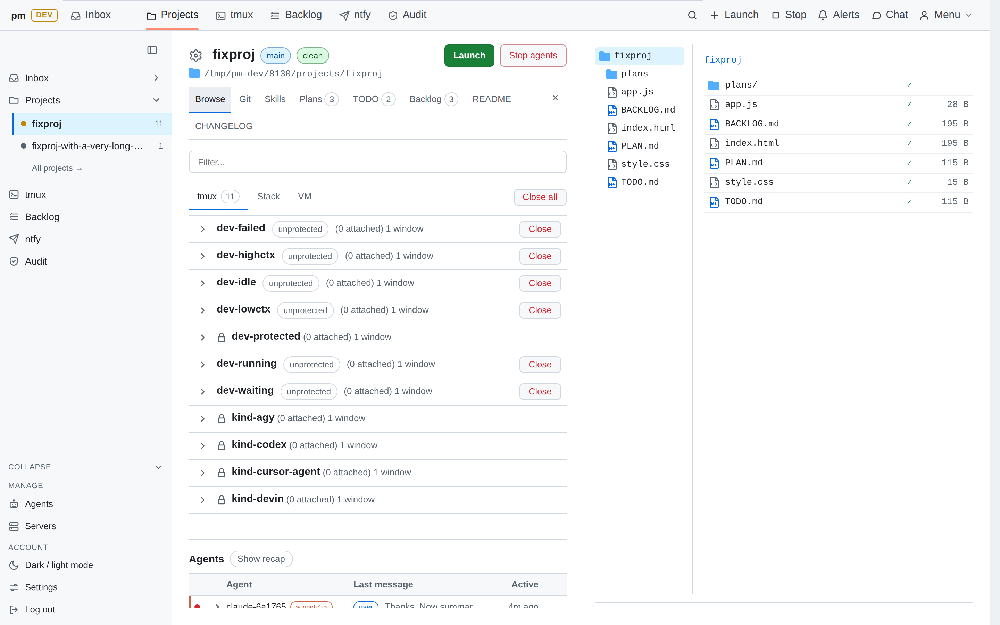 | 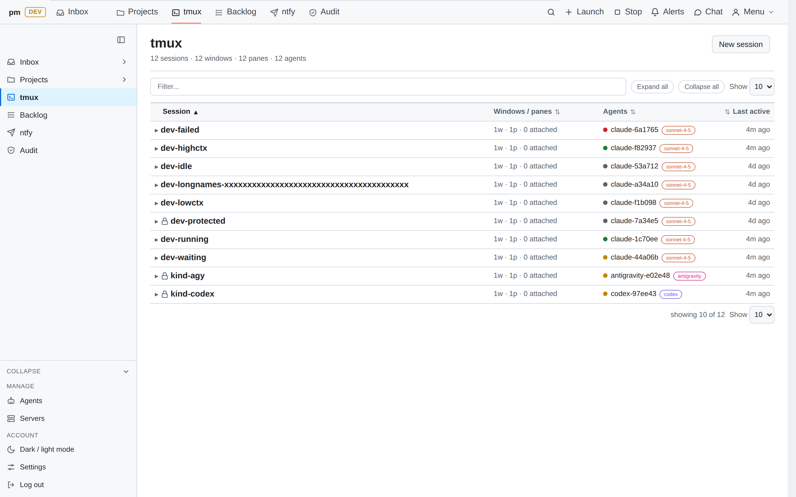 |

More: [projects](docs/screenshot/v0/02-projects-light.png), [agents library](docs/screenshot/v0/06-agents-light.png),
[backlog](docs/screenshot/v0/07-backlog-light.png), [audit](docs/screenshot/v0/08-audit-light.png),
[ntfy](docs/screenshot/v0/09-ntfy-light.png).

## Quick start

```sh
git clone https://github.com/dungtq/polymux.git
cd polymux
uv sync
uv run pm
```

Open <http://127.0.0.1:8093>. On first start pm creates a login token in
`~/.config/pm/token` (mode 0600). Paste its content into the login form.

Plain `http://` works only on `127.0.0.1` / `localhost`, because the session
cookie is `Secure`. For any other address put pm behind a TLS reverse proxy
(see [docs/INSTALL.md](docs/INSTALL.md)).

pm's git panel fetches, pulls and pushes the remote named `gitdev`. Add your
push remote under that name in each project:

```sh
git remote add gitdev git@git.example.lan:you/project.git
```

## Requirements

| Need | Version | Required |
|---|---|---|
| Linux | any recent | yes (reads `/proc`, uses a pty) |
| Python | 3.13 or newer, via uv 0.12+ | yes |
| tmux | same version as your running tmux server | yes |
| git | 2.x | yes |
| Docker + Compose v2 | | no (Stacks, containers) |
| libvirt `virsh` + `qemu-img` | | no (VMs) |
| ntfy server | | no (notifications) |
| Coding-agent CLIs (`claude`, `codex`, `devin`, `cursor-agent`) | | no (what you want to launch) |
| `tmux-agents` (bundled in `deploy/tmux-agents/`) | | no (agent ids, agent-to-agent messages) |

Full table and what breaks without each: [docs/INSTALL.md](docs/INSTALL.md).

## Documentation

| Doc | Content |
|---|---|
| [docs/INSTALL.md](docs/INSTALL.md) | Install, systemd unit, reverse proxy, hook, upgrade, uninstall |
| [docs/CONFIG.md](docs/CONFIG.md) | Every `pm.toml` key with its default |
| [docs/claude-hook.md](docs/claude-hook.md) | Claude Code hook for instant agent state |
| [docs/operations.md](docs/operations.md) | Running, state files, backup, troubleshooting |
| [docs/ARCHITECTURE.md](docs/ARCHITECTURE.md) | Code layout and rules for contributors |
| [SECURITY.md](SECURITY.md) | Security model and how to report a problem |
| [CONTRIBUTING.md](CONTRIBUTING.md) | Dev setup, tests, checks, pull requests |
| [CHANGELOG.md](CHANGELOG.md) | Release notes |

## License

MIT. See [LICENSE](LICENSE). Bundled third-party files: [THIRD_PARTY_NOTICES.md](THIRD_PARTY_NOTICES.md).
